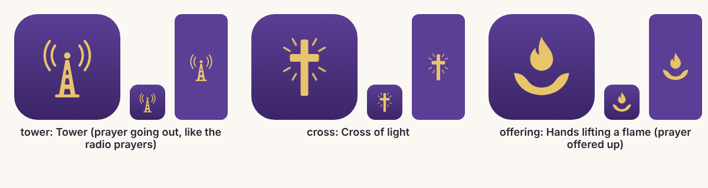

# App icon and splash

Three draft options, drawn in code so they're easy to swap. **"tower" is the default.** A designer should finalize the icon before App Store review (see the launch checklist).



| Option | Idea |
|---|---|
| `tower` (default) | A prayer tower sending prayer out, echoing the radio prayers and Priestly tokens |
| `cross` | A cross of light |
| `offering` | Hands lifting a flame: prayer offered up |

## Switching

```bash
npm run brand -- cross                 # or tower, offering
npm run brand -- --preview build/icon-options   # redraw the comparison sheet
```

This rewrites the files `apps/mobile/app.json` already points at, in `apps/mobile/assets/images/`. A new build is needed for the change to show. To add an option or change colors, edit `scripts/branding/marks.mjs`. The script uses Playwright, which `npm install` already brings in for the e2e tests.

## What the script produces (and why)

| File | Size | Rule |
|---|---|---|
| `icon.png` | 1024×1024, no transparency | Expo: "fills the whole square, with no rounded corners or other transparent pixels" ([Expo](https://docs.expo.dev/develop/user-interface/splash-screen-and-app-icon/)) |
| `splash-icon.png` | 1024×1024, transparent | Expo: "Use a 1024x1024 image… transparent background" ([Expo](https://docs.expo.dev/develop/user-interface/splash-screen-and-app-icon/)). The background color is set in `app.json` (`#5B3E96`). |
| `android-icon-foreground.png`, `android-icon-monochrome.png` | 1024×1024, transparent | The logo stays inside the central 66 of 108 dp, which no device mask clips ([Android](https://developer.android.com/develop/ui/views/launch/icon_design_adaptive)) |
| `android-icon-background.png` | 1024×1024 | Must match the foreground's size ([Expo](https://docs.expo.dev/develop/user-interface/splash-screen-and-app-icon/)) |
| `favicon.png` | 48×48 | Web build |
