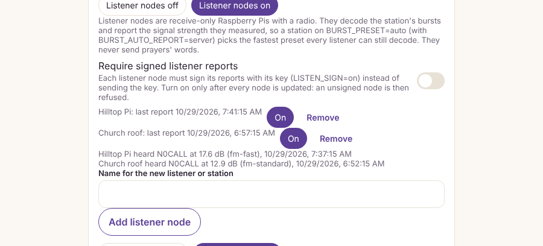
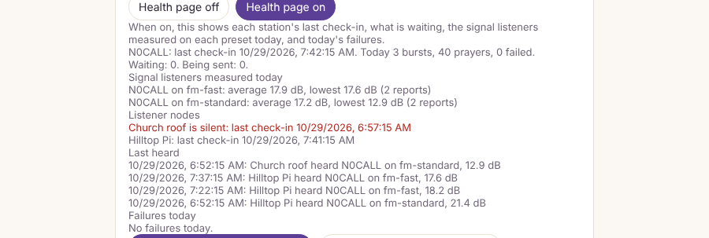
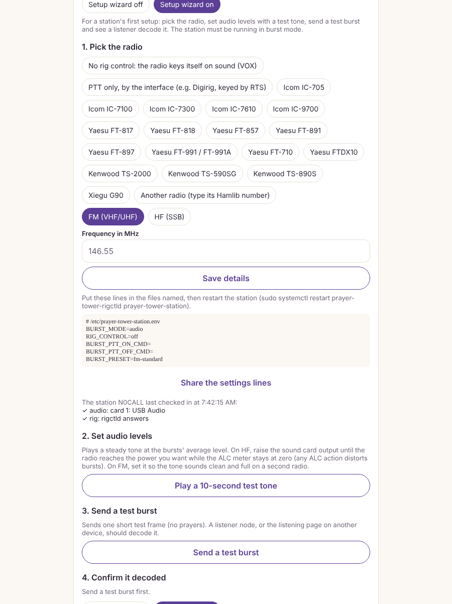
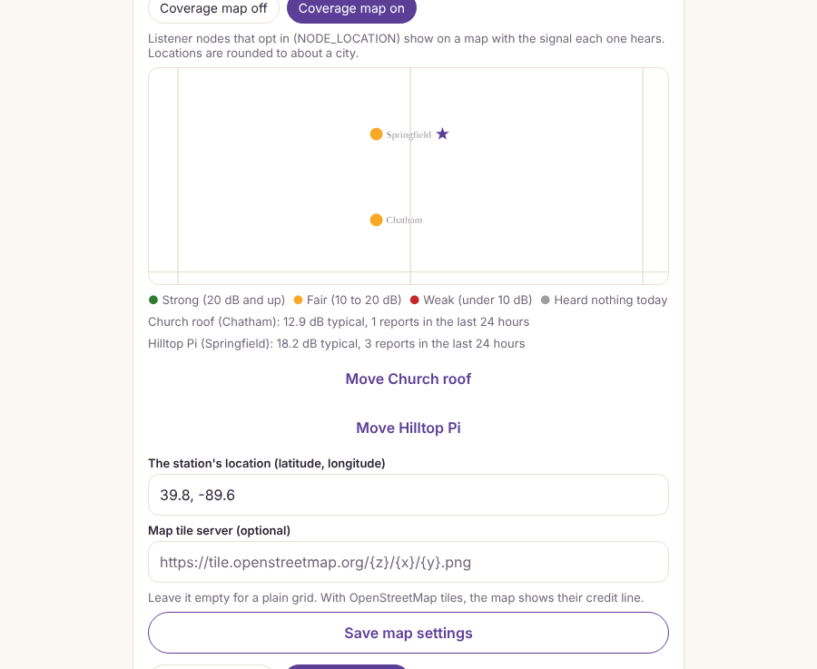
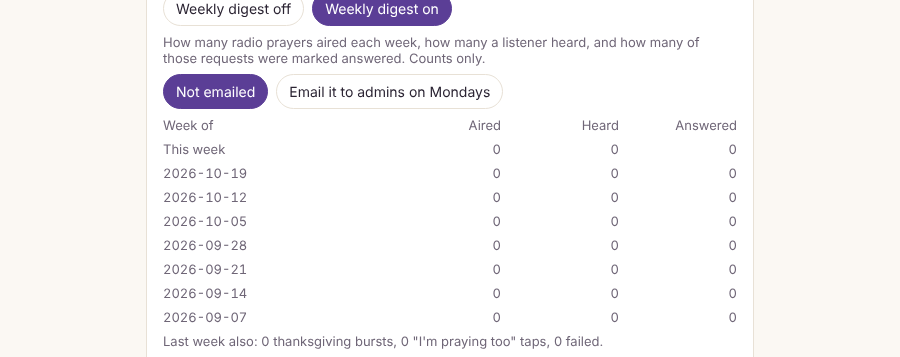
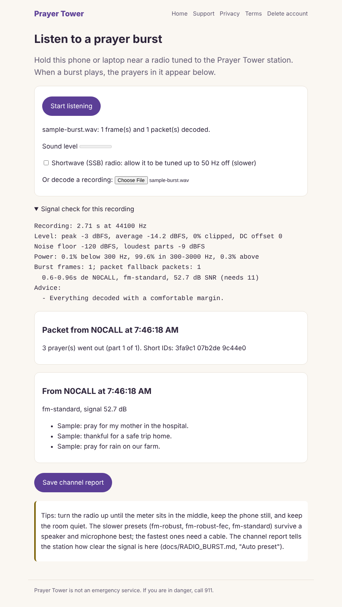

# Station operator guide (burst mode)

For the station's control operator (Ginni). This covers wiring an FM radio to
the station computer, the radio and sound card settings, which preset to use,
and the first tests, from no radio at all up to a real burst on the air. The
station software is already installed ([RADIO_STATION_INSTALL.md](RADIO_STATION_INSTALL.md));
the format and every setting are in [RADIO_BURST.md](RADIO_BURST.md).

New to the station? Start with the one-page [control operator quick start](CONTROL_OPERATOR_QUICK_START.md).

## Features at a glance

Every feature below is off until an admin turns it on. Admin → Radio holds the
switches; the station settings go in `/etc/prayer-tower-station.env`.

| Feature | Turn it on | Section |
| --- | --- | --- |
| Setup wizard (rig, levels, test burst) | Admin → Radio → Setup wizard | [Setup wizard](#setup-wizard) |
| Listener nodes (receive-only reports) | Admin → Radio → Listener nodes | [Listener nodes](#listener-nodes-receive-only-real-data-for-the-auto-preset) |
| Signed listener reports | Admin → Radio → Listener nodes, plus `LISTEN_SIGN=on` | [Security](#security) |
| Several stations, one queue | Admin → Radio → Several stations | [Several stations](#several-stations-one-shared-queue) |
| Health alerts | Admin → Radio → Station alerts | [Health alerts](#health-alerts-in-admin--radio) |
| Health page (heartbeats, last heard) | Admin → Radio → Health page | [Health page](#health-page-in-admin--radio) |
| Listener acknowledgements | Admin → Radio → Listener acknowledgements | [Listener acknowledgements](#listener-acknowledgements) |
| Urgent requests first | Admin → Radio → Urgent requests first | [Queue order](#queue-order) |
| Operator console (queue, window, ID timer, log, hold and send-now) | Admin → Radio → Operator console on, plus the Radio operator role | [Operator console](#operator-console) |
| Operator alerts (push on station problems) | Admin → Radio → Operator alerts | [Operator alerts](#operator-alerts) |
| Reception beacon (test burst on a schedule, logged per listener) | Admin → Radio → Reception beacon | [Reception beacon](#reception-beacon) |
| Fair air (every request on the air once; a daily cap per member) | Admin → Radio → Every request on the air once, Radio sends per member a day | [Fair air](#fair-air) |
| My signal queue and signal codes (a member's own radio prayers; the same code on the Listen screen) | Admin → Radio → My signal queue | [My signal queue](#my-signal-queue) |
| Where it was heard (receivers that decoded each radio prayer, shown to the sender and asker) | Admin → Radio → Where it was heard | [Where it was heard](#where-it-was-heard) |
| Scheduled radio sends (a request goes out by radio, or amplified, at a set time) | Admin → Radio → Scheduled radio sends | [Scheduled radio sends](#scheduled-radio-sends) |
| Prayer without ceasing (kept requests go out again when the air is quiet) | Admin → Radio → Prayer without ceasing | [Prayer without ceasing](#prayer-without-ceasing) |
| Dish and sky target (where to point, rotator follows, hold while low) | Admin → Radio → Dish and sky target, plus `ROTATOR=rotctld` to turn a rotator | [Dish and sky target](#dish-and-sky-target) |
| Transmission windows | Admin → Radio → Transmission windows | [Transmission windows](#transmission-windows-and-quiet-hours) |
| Coverage map | Admin → Radio → Coverage map, plus `NODE_LOCATION` | [Coverage map](#coverage-map) |
| Weekly radio digest | Admin → Radio → Weekly digest | [Weekly radio digest](#weekly-radio-digest) |
| Packet fallback (1200-baud APRS) | Admin → Radio → Packet fallback, plus `BURST_MODE=packet` | [Packet fallback](#packet-fallback) |
| Decode replay and diagnostics | Always available (offline tool) | [Diagnose a weak signal](#diagnose-a-weak-signal) |
| Compression v2 (codec 4) | `BURST_CODEC_V2=on`, after every receiver is updated | [RADIO_BURST.md](RADIO_BURST.md#compression-v2-codec-4) |
| Store-and-forward relay | `RELAY=on` on a listener node with a transmitter | [RADIO_BURST.md](RADIO_BURST.md#store-and-forward-relay) |

Screenshots of these screens (sample data, 2026-10-29) are in [images/radio/](images/radio/).

## One-command install

On a Pi that is already running Raspberry Pi OS:

```
curl -fsSL https://raw.githubusercontent.com/zoomatech/PrayerTower/main/apps/station/install/get-station.sh | sudo bash -s -- --hamlib
```

This fetches the code to `/opt/prayer-tower-src` and runs `install.sh`. That
installs Node.js 22, the station service, the health check and, with
`--hamlib`, rigctld set to the dummy radio. Add `--fldigi` for fldigi. Run the
same command again to update; your settings files are kept. If the repository
is private, add `--repo https://<token>@github.com/zoomatech/PrayerTower.git`.
The token is not kept on disk.

**A Pi that sets itself up on first boot.** This needs Raspberry Pi OS Trixie,
from November 2025 or later.

1. Write it to the SD card with Raspberry Pi Imager. The card's boot partition
   then holds a `user-data` file, which cloud-init reads on first boot.
2. Replace that file with
   [`apps/station/install/pi/user-data`](../apps/station/install/pi/user-data).
   First change the password (`change-me-now` is a placeholder) and the time
   zone.
3. Put the card in the Pi and power it on. It creates the `station` user,
   then runs the one-command install, logging to
   `/var/log/prayer-tower-install.log`.
4. Sign in over SSH (`ssh station@prayer-station.local`). Fill in
   `/etc/prayer-tower-station.env` and `/etc/prayer-tower-rigctld.env`, then
   start the station:

   ```
   sudo systemctl start prayer-tower-station
   ```

**Tested on every change.** Each change to the station or its installers runs both installers
on throwaway machines (`.github/workflows/station-install.yml`): this one on Ubuntu with
systemd, and the Mac one with launchd. Each install runs the station in simulate mode against a
stand-in server, so nothing is keyed. It checks that a burst is sent, decoded and reported, that
the health check and rig control (the dummy radio) work, and that updating and uninstalling
leave the settings in place. The Pi first-boot file is checked against cloud-init's schema.
The script is `apps/station/install/ci/dry-run.sh`. Never run it on a station that is on the air.

## What you need

- An FM transceiver. A mobile with a 6-pin mini-DIN **data port** is best,
  because that port's audio skips the microphone circuits. A handheld works
  through its speaker/mic jack.
- A USB sound card interface with PTT. A Digirig Mobile is one example: one
  USB cable gives the computer a sound card and a serial port whose RTS line
  keys the radio. Use the cable made for your radio.
- A second receiver for testing (any scanner, handheld or SDR), or a phone
  with the Prayer Tower listening page (`/listen`).
- A dummy load for the first transmit tests.

## 1. Radio settings

Set these in the radio's menu (names differ by make; the manual has them):

| Setting | Set to | Why |
| --- | --- | --- |
| Mic compressor / speech processor ("PROC", "COMP") | **Off** | It squashes loud moments and lifts quiet ones. Burst audio needs its level left alone, and the QAM presets carry data in the level itself. |
| Data port speed | **1200** for the `fm-` presets, **9600** for the `dataport-` presets | At 1200 the port's audio passes through the usual voice filtering. At 9600 it is flat and wide, which the `dataport-` presets need. |
| APRS / packet features | Off | They can key the radio or take over the data port. The [packet fallback](#packet-fallback) makes its own 1200-baud audio, so it needs these off too. |
| VOX | Off, unless you key by VOX on purpose | The station keys the radio itself (step 3). |
| Squelch (receiving radio) | Just above the noise, or open | A slow squelch can cut off the start of a burst. The station adds 100 ms of silence before each burst and waits `BURST_PTT_DELAY_MS` (300 ms) after keying. |
| Power | Low for tests | The radio is keyed for seconds at a time; handhelds have no fan. |

## 2. Sound card levels

The station plays the burst through the interface's sound card. List the
cards with `aplay -l` and `arecord -l`, then set levels with `alsamixer`
(press F6 to choose the USB card).

- **Turn off automatic gain control** on the capture side if the mixer shows
  it ("Auto Gain Control" → MM). It changes the level in the middle of a burst.
- **Transmit level (deviation).** Aim for about 2 to 3 kHz deviation. With a
  deviation meter or SDR, read it directly. Without one, use a monitor radio:
  start with the playback level low, send a test burst (step 5), and raise
  the level until the monitor stops getting louder or starts to distort. Then
  back it off until you hear a clear drop. Set the level once; don't move it
  between bursts.
- **Receive level** (for a receiving station): with only noise on the
  channel, set capture so the noise sits around -10 dBFS. That leaves room
  for the burst without clipping.
- Keep everything else on the computer away from that sound card, so system
  sounds never go out on the air.

## 3. Push-to-talk

With a Digirig or another serial-RTS interface, run hamlib's `rigctld` as a
service so it holds the serial port. If a one-shot command opens and closes
the port, RTS drops and the radio unkeys:

```
rigctld -m 1 -p /dev/ttyUSB0 -P RTS
```

(`-m 1` is hamlib's dummy rig: no CAT, just PTT on the port named by `-p`.)
Then in `/etc/prayer-tower-station.env`:

```
BURST_PTT_ON_CMD=rigctl -m 2 T 1
BURST_PTT_OFF_CMD=rigctl -m 2 T 0
BURST_PLAY_CMD=aplay -q -D plughw:CARD=Device,DEV=0 {wav}
```

`rigctl -m 2` talks to the running `rigctld`; `T 1` keys and `T 0` unkeys.
Use the card name `aplay -l` showed. The station service may open the sound
card (and nothing else in `/dev`) and runs in the `audio` group. Turn off hardware flow control on that
serial port in any other program that opens it, or it may key the radio.

So the radio is never left on the air, the station runs the unkey command after every burst, even a failed one. It also runs it when the key command itself fails, since the radio may have keyed first. If the unkey command fails, it waits half a second and tries once more. A play or PTT command that runs past its time limit is stopped along with anything it started. The station also unkeys once when it starts, in case it last stopped in the middle of a burst while `rigctld` was holding PTT, and it unkeys before exiting if it crashes.

## Rig control (frequency, mode and PTT through Hamlib)

Off by default. With it on, the station sets the radio's frequency and mode
when it starts and keys PTT through Hamlib's `rigctld`. After keying, it reads
PTT back, so a radio that ignored the command is caught before any audio
plays: the station unkeys and stops, the same as any other transmit failure.

1. Install rigctld as a service:

   ```
   sudo apps/station/install/install.sh --hamlib
   ```

   This installs `libhamlib-utils` and `prayer-tower-rigctld.service`, which
   listens on this machine only (127.0.0.1:4532). It also creates
   `/etc/prayer-tower-rigctld.env`.
2. In `/etc/prayer-tower-rigctld.env`, replace the placeholder radio. `RIG_MODEL=1` is Hamlib's dummy radio, so everything can be
   tried with no radio connected. Find your radio's number with `rigctl -l`,
   then set `RIG_DEVICE` (the CAT port, best as
   `/dev/serial/by-id/...`) and `RIG_SPEED` (the CAT baud rate from the
   radio's menu). For a PTT-only interface such as a Digirig keyed by RTS,
   keep `RIG_MODEL=1` and set `RIG_EXTRA_ARGS=-p /dev/ttyUSB0 -P RTS`.
3. In `/etc/prayer-tower-station.env`:

   ```
   RIG_CONTROL=rigctld
   RIG_FREQ_HZ=145050000
   RIG_MODE=FM
   ```

   On HF use `RIG_MODE=PKTUSB` (the radio's DATA mode) with
   `RIG_PASSBAND_HZ=3000`. Leave `RIG_FREQ_HZ` or `RIG_MODE` out to keep
   whatever the radio is set to. With rig control on, the
   `BURST_PTT_ON_CMD` and `BURST_PTT_OFF_CMD` lines are not used.
4. Restart both services, then check them:

   ```
   sudo systemctl restart prayer-tower-rigctld prayer-tower-station
   rigctl -m 2 f            # the frequency, read through rigctld
   sudo -u prayer-station node /opt/prayer-tower-station/dist/src/health.js
   ```

   The health check adds a `rig` line. It fails if rigctld is not answering,
   or if the radio is transmitting between bursts (a stuck PTT).

## Station on a Mac

The station also runs on a Mac (Steve's, for example), as background jobs for the
signed-in user. No sudo is needed. In Terminal:

```
curl -fsSL https://raw.githubusercontent.com/zoomatech/PrayerTower/main/apps/station/install/mac/install-mac.sh | bash -s -- --hamlib
```

Or, from a clone of the repository, run `bash apps/station/install/mac/install-mac.sh --hamlib`.

- **What it needs:** Node.js 22. If the Mac doesn't have it, the installer uses Homebrew's
  `node@22`. `--hamlib` adds Hamlib (rigctld) from Homebrew, and `--listener` adds
  sox (for recording). With no Homebrew and no Node.js 22, it says what to install.
- **Settings:** the same files as on a Pi, in `~/Library/Application Support/PrayerTower/config/`
  (`station.env`, `rigctld.env`, `listener.env`). Fill in `station.env`, then
  run the installer again to start the station. Rig control works the same way
  (`RIG_CONTROL=rigctld`). The radio's CAT port is a `/dev/cu.usbserial-…` name;
  list them with `ls /dev/cu.*`.
- **Sound:** bursts play with `afplay`, which is built into macOS, through the default
  output. Choose the USB interface in System Settings > Sound > Output, and
  turn alert sounds down so they don't go out over the air.
- **Jobs:** one launchd agent for each job (`com.zoomatech.prayertower.station`,
  `.rigctld`, `.listener`). They start at login and restart after a crash. After a
  failed transmission the station stays stopped until someone checks the radio, then:
  `launchctl kickstart gui/$(id -u)/com.zoomatech.prayertower.station`.
- **Logs and checks:**
  - Logs: `tail -f ~/Library/Logs/PrayerTower/station.log`.
  - Health check: `bash ~/Library/Application\ Support/PrayerTower/station/run.sh health`.
- **Listener on a Mac:** `--listener` records with sox's `rec` from the default
  input. macOS asks for microphone permission the first time. If it blocks the
  background job, run `bash ~/Library/Application\ Support/PrayerTower/station/run.sh listener` in
  Terminal and allow Terminal to use the microphone.
- **Keep it awake:** in System Settings > Battery (or Energy), stop the Mac
  from sleeping while the station is on duty.
- **Update or remove:** run the same installer again to update. `--uninstall` removes
  the jobs and keeps your settings.

## Listener nodes (receive only, real data for the auto preset)

A listener node is a Raspberry Pi with a receiver (a scanner, an old handheld or
an SDR) plugged into its sound card. It never transmits. It records all the time,
decodes the station's bursts, and sends Prayer Tower only what it measured: the
call sign, the preset and the SNR. It also sends the fingerprints of the prayers
it decoded, never their words. Those fingerprints acknowledge the prayers (see
[Listener acknowledgements](#listener-acknowledgements)) and, with receipts on,
tell senders a listener heard them. It checks in about once a minute even when it
hears nothing. A station on `BURST_PRESET=auto` then picks the
fastest preset that the weakest listener can still decode. Off by default.

1. In Admin → Radio (burst mode), turn on **Listener nodes**, type a name
   (e.g. "Hilltop Pi") and tap **Add listener node**. Copy the key. It is
   shown only once, and the server keeps only its hash.
2. On the listener Pi:

   ```
   curl -fsSL https://raw.githubusercontent.com/zoomatech/PrayerTower/main/apps/station/install/get-station.sh | sudo bash -s -- --listener-only
   sudo nano /etc/prayer-tower-listener.env     # PRAYER_TOWER_API_URL, NODE_KEY
   sudo systemctl start prayer-tower-listener
   journalctl -u prayer-tower-listener -f        # "[listener] heard N0CALL: 1 frame(s), 24.5 dB, fm-standard"
   ```

   Set the receiver's sound card in `LISTEN_RECORD_CMD` (the card name from
   `arecord -l`). From an HF (SSB) receiver, also set `LISTEN_SEARCH_HZ=50`.
   For a Pi that sets itself up on first boot, change `--hamlib` to
   `--listener-only` in `pi/user-data`.
3. On the station, in `/etc/prayer-tower-station.env`:

   ```
   BURST_PRESET=auto
   BURST_AUTO_REPORT=server
   ```

   Before each burst the station asks Prayer Tower (`GET /station/channel`).
   The answer is each enabled listener's latest report from the last 30
   minutes, and the weakest of them. With no fresh report, the station uses
   the most robust preset in `BURST_AUTO_PRESETS`.

Admin → Radio lists each node, when it last reported and what it last heard.
Turning a node off stops its key working and its reports counting. A node on the
same machine as the station can also write `LISTEN_REPORT_FILE`, which the
station reads as a plain `BURST_AUTO_REPORT` file.

If the internet or Prayer Tower is down, the node keeps the reports it could not send, up to 500 for up to 23 hours. It sends them, oldest first, as soon as the server answers again ("sent N kept report(s)" in its log). That way a prayer it heard during the outage still counts as heard, and the station doesn't send it again. They are kept in `outbox.json` in the node's state directory, so a restart or a power cut doesn't lose them. A report the server refuses, such as one with a wrong key, is not kept.



## Several stations (one shared queue)

Off by default. Several stations, for example one on FM and one on HF, or the
Pi and Steve's Mac, can share one queue without sending any prayer twice:

- When a station claims prayers, the server locks those rows and skips any that
  another station has locked (`for update skip locked`). Two stations asking at the same moment
  get different prayers.
- Each claim records which station holds it, and only that station can report it sent or failed.
- A claim with no report for 15 minutes goes back to the queue. If the
  late station reports after another one has claimed it, that report is
  refused.

To add a station:

1. In Admin → Radio, choose **Several stations**, type a name, and tap **Add station**.
   Copy the key. It is shown only once.
2. On the new station, put that key in `STATION_API_KEY` (in
   `/etc/prayer-tower-station.env`, or `station.env` on a Mac). Give the station
   its own control operator's `CALL_SIGN`. Everything else is set up as for the
   first station.
3. Admin → Radio shows each station's last check-in, what it is sending now and
   what it sent in the last 24 hours. Turning a station off stops its key at once.
   The main station's key (the server's `STATION_API_KEY`) always works.

Health alerts and the burst log already list each station by its call sign.

## Health alerts in Admin → Radio

Off by default. In Admin → Radio (station mode), turn on **Station alerts**.
About once a minute the station reports its own checks, and the server adds
what it can see. Problems also reach admins as an in-app alert, at most once
an hour.

| Alert | What it means | Comes from |
| --- | --- | --- |
| No sound card | ALSA lists no sound card (`/proc/asound/cards`), so bursts can't play. Check the USB interface. | The station (BURST_MODE=audio) |
| The radio did not key (PTT) | rigctld is not answering, the radio ignored PTT, or it is stuck transmitting. A failed burst whose error names PTT counts too. | The station (RIG_CONTROL=rigctld) and the burst log |
| The last burst failed | Any other transmit error. The station has stopped itself until someone checks it. | The burst log |
| A burst is overdue | A prayer has waited longer than the chosen limit (15, 30, 60 or 120 minutes; 30 by default). | The queue |
| The station stopped reporting | No report for 10 minutes. | The station |
| A listener node stopped checking in | An enabled listener node that checked in before has been quiet for 30 minutes (only while listener nodes are on). This is information, not a problem. | The listener nodes |
| Nothing is waiting | The queue is empty. This is information, not a problem. | The queue |


## Health page in Admin → Radio

Off by default. In Admin → Radio (station mode), turn on **Health page**. It shows:

- Each station by call sign: its last check-in (about once a minute), any check
  that is failing (sound card, PTT), and the last 24 hours of bursts, prayers and
  failures. A station with no check-in for 10 minutes is shown in red as stopped.
- The queue: how many prayers are waiting, how many are being sent, and how long the oldest has waited.
- The signal listeners measured on each preset in the last 24 hours: the average,
  the lowest and the number of reports. This helps when you choose a preset, or
  set `BURST_AUTO_PRESETS`.
- The last 10 failures in the last 24 hours, failed bursts and failed prayers, with their errors.
- Each listener node's last check-in (its heartbeat). A node quiet for 30 minutes is shown in red.
- The last-heard list: the 15 latest decodes listener nodes reported, with the
  node, the station's call sign, the preset and the measured SNR.



## Queue order

Admin → Radio → "Which prayer goes out next" picks **First in, first out**
(the default) or **By need** ([RADIO_STATION.md](RADIO_STATION.md#prayers-by-need)).
**Urgent requests first** (off by default) puts requests marked "Today" or
"Right now" ahead of everything else, whichever order is chosen. It applies to
single prayers, bursts and the packet fallback alike.


## Listener acknowledgements

Off by default. When **Listener acknowledgements** is on, a prayer counts as
heard on the air only once a listener decodes it. That listener can be a
listener node, the /listen page or the app's Listen screen. The listener sends
back the prayer's fingerprint, never its words.

- If no listener hears a prayer within the chosen time (5, 10, 30 or 60
  minutes; 10 by default), it goes back in the queue and the station sends it
  again, up to the chosen number of times (0 to 3; 2 by default). After the last
  try it stays sent, and is counted as not heard.
- Prayers are sent again only while an enabled listener node has checked in
  within the last 5 minutes. With no listener running, nothing could have heard
  the prayer, so nothing is sent again.
- Admin → Radio shows the last 24 hours: how many were heard, how many are
  waiting for a listener, how many were not heard after every try, and how many
  were sent again.
- The sender's "on the air" receipt goes out once, the first time. The "a
  listener heard it" receipt goes out when it is first decoded, and only while
  receipts are on.

Put at least one listener node where it hears the station the way your
listeners do. A listener right next to the station hears everything, so it
proves nothing about reach.

## Transmission windows and quiet hours

Off by default. In Admin → Radio, turn on **Transmission windows**, set the time
zone (a name such as `America/Chicago`), and add windows: the days and the
hours the station may send, for example Monday to Friday 18:00 to 21:00. A
window whose end is earlier than its start runs past midnight, and belongs to the
day it starts on. With no windows the station may send at any time outside the
quiet hours. Quiet hours (for example 22:00 to 06:00) always win.

Outside the windows, the station asks for prayers as usual and gets none. The
prayers wait in the queue and go out in the next window. Admin → Radio shows
whether the station may send now. The "burst overdue" alert is not raised while
the station is off the air on purpose.

## Station ID

Off by default. Every burst frame already carries the call sign in digital form.
With `STATION_ID=cw` in the station's settings, the station also sends its call
sign in Morse code (`DE K1ABC`, 20 words a minute, an 800 Hz tone) at the end of
a key-up. It does this on the first key-up, and then whenever
`STATION_ID_MINUTES` (10) have passed since the last ID. `STATION_ID_WPM` and
`STATION_ID_TONE_HZ` change the speed and the tone. In `BURST_MODE=fldigi`, the
ID is a `de K1ABC` line at the end of the key-up. The PSK31 mode already ends
every piece with `de K1ABC`. In simulate mode, the log shows when an ID would
have gone out.

## Operator console

One screen for the control operator: Me → **Operator console**. It is off until an admin picks **Operator console on** in Admin → Radio (shown when the transmitter is the station). Admins can use it, and so can anyone given the **Radio operator** role (Admin → People, or `npm run grant-role -- <email> radio_operator`). Members without the role get a plain "this page is for the team" message.

| Part | What it shows |
| --- | --- |
| Problems right now | Shown first, in red, only when there is one: no sound card, the radio did not key, the last burst failed, a burst is overdue, or a station stopped reporting, with its call sign and detail. These are the same checks as the [health alerts](#health-alerts-in-admin--radio), shown whether or not those switches are on. |
| Status | Whether the station may transmit now, and why not: held, outside the transmission windows, or sending under an override until a given time. |
| Manual override | **Hold all transmissions**: the station is handed nothing new until **Resume** (a burst already on the air finishes). **Send for 15 / 30 / 60 min**: sends outside the windows and quiet hours, then the windows apply again on their own; **End override** stops it early. |
| Station ID timer | For each station: when it last identified, how often it must (`STATION_ID_MINUTES`), and when the next ID is due. The station reports this as its `station_id` check. |
| Queue | How many prayers are waiting and sending, how long the oldest has waited, and the next 10, in the order the station will be handed them, with their wait, urgency and repeats. |
| Relays | Each [store-and-forward relay](RADIO_BURST.md#store-and-forward-relay) that reported in the last hour: frames re-sent and air time used of its budget, and frames it did not re-send by reason. A relay sends this with its listener heartbeat. |
| Reception beacon | When the [reception beacon](#reception-beacon) is on: the last day's beacons and every receiver that heard each one, with its SNR. |
| Prayer without ceasing | When [prayer without ceasing](#prayer-without-ceasing) is on: how many kept requests are in the rotation, the quiet time before one goes out, and how many went out again in the last day. |
| Dish and sky target | When the [sky target](#dish-and-sky-target) is on and the dish location is set: where to point now (azimuth and elevation), when the target next rises or sets past the lowest useful elevation, and whether transmissions are held because it is too low. |
| Log | The last 20 transmissions in 24 hours (the same rows as the [operator log](#operator-log)): time, call sign, preset, sent or failed, heard by a listener, and the text. |

The screen refreshes every 15 seconds. Holds and overrides are recorded in Admin → Audit log. Turning the console off lifts any hold or override, so nothing stays held by a screen no one can open.

### On a Mac: Prayer Tower Console

On a Mac, the control operator uses the native **Prayer Tower Console** app instead of the web console (`apps/ios-native/Console`, scheme `PrayerTowerConsole`). It signs in with the same account and shows the same parts, plus **Station health** for admins, all following the same switches. Its keying controls follow these safety rules:

- **Hold** is always one click and never asks first. It is also in the **Station** menu and the menu bar item, with **⌘.**.
- **Resume** and **Send for 15 / 30 / 60 min** ask first, since they let the station key the radio.
- While the radio did not key or may be stuck transmitting (the "radio did not key" problem), Resume and Send for are not offered. Hold, then fix the PTT as in the [quick start](CONTROL_OPERATOR_QUICK_START.md).
- Send for is not offered while held, since a hold outranks it.
- The console also warns when no station has reported in, when a station is due to identify, and when the dish target holds transmissions (an override does not lift that hold).

The menu bar item shows whether the station may transmit, held, or has a problem, with the queue and a Hold button. ⌘R refreshes.

With no server settings in `Config.xcconfig`, the app opens with **sample data** and no sign-in. Hold, Resume and Send for change only the sample, and nothing reaches a radio. The sign-in screen also has **Look around with sample data**.

## Operator alerts

Off until an admin turns on **Operator alerts** in Admin → Radio (under the operator console switch). Every 2 minutes the server checks the same problems as the [health alerts](#health-alerts-in-admin--radio): no sound card, the radio did not key, the last burst failed, prayers overdue, a station that stopped reporting. When one starts, every radio operator and admin gets a notice (a push, unless they turned pushes off or are in quiet hours). It is sent once while the problem lasts. When it clears, they get a quiet in-app "Back to normal" note. Information-only alerts (an empty queue, a quiet listener node) are never sent. This works whether or not the health alerts card is on.

## Reception beacon

Off until an admin turns on **Reception beacon** in Admin → Radio (under the operator console switch) and picks how often: every 30, 60 (the default), 120 or 240 minutes. Each time, the station sends the setup wizard's short test burst ("Station test" and a code, with its call sign in the frame). The station needs no new settings, and the setup wizard itself can stay off. Every listener node and listening page that decodes the beacon reports it, and each receiver is kept with its signal-to-noise ratio. The operator console shows the last 24 hours: when each beacon went out, which receivers heard it and how strongly, or that none did. This makes changes in reception through the day easy to see.

No beacon goes out while the console's hold is on or outside the transmission windows. Turning the beacon off drops any beacon still waiting for the station. While a beacon is waiting (up to 5 minutes), a setup wizard test has to wait for it.

## Fair air

Two settings in Admin → Radio, both off by default.

**Every request on the air once.** From the notebook's Page 2: "a lack of tokens will never stop a prayer request from being seen and minimally broadcast." Every 5 minutes the server queues one free send for each prayer request from the last day that has not been on the radio yet. It leaves out sensitive requests, laments kept off the radio, requests waiting on a moderator, answered ones, and communities with the radio hidden. The station sends these after the prayers members sent themselves. Turning it off drops any still waiting.

**Radio sends per member a day.** From the Donor Influence page (people amplifying prayers "on both sides" to flood the air). Choose no limit, 3, 10 or 30. Within 24 hours a member can send at most that many radio prayers; an amplified send counts once for each time it goes out. Past the limit the member is told why. A scheduled radio send that would pass it is skipped that week, with the same message to the member; a repeating schedule goes on the next week.

## My signal queue

From the first prototype's Signal Queue tab. Off until an admin turns on **My signal queue** in Admin → Radio.

While it is on, members have **My signal queue** on their profile: their own radio prayers, newest first, each waiting, going out, sent or not sent, amplified or not, with the call sign and preset it went out on and how many receivers reported it. Each one that went out has a signal code such as `Q7MK-4XPL-9RT2`: 60 bits of the fingerprint of the exact text sent (the same fingerprint the station reports and listeners send back), written in 32 letters and digits with no I, O, 0 or 1. The Listen screen shows the same code under each prayer it decodes, so a sender and a listener can match a transmission without either learning who the other is. Re-sends from [prayer without ceasing](#prayer-without-ceasing) are left out of the list.

## Where it was heard

From the HAM Operators notebook page ("a trail of all the places and ears that have heard that prayer"), with real reports only. Off until an admin turns on **Where it was heard** in Admin → Radio.

While it is on, every receiver that decodes a radio prayer is kept: a [listener node](#listener-nodes-receive-only-real-data-for-the-auto-preset) by its name with its best signal-to-noise ratio, and a phone or listening page only as a count (never who or where). The member who sent the prayer and the person who asked see **Where it was heard** on the request: each time it went out (and whether amplified), from which call sign, the nodes that heard it and how many phones did. Nobody else sees it. Nothing is estimated: a prayer no receiver reported says so. It needs listener nodes or [receipts](RADIO_BURST.md) on for reports to arrive. Reports for packet fallback IDs count the same way.

## Scheduled radio sends

From the Dominic notebook page ("2,500 on Friday, 2,500 on Saturday and the rest at the start of the game", amplified). Off until an admin turns on **Scheduled radio sends** in Admin → Radio.

While it is on, a request's screen has **Schedule a radio send**. The member picks a time (Friday 7 pm, Saturday 9 am, Sunday 9 am or their own), once or weekly for 4 or 12 weeks, and whether to amplify. At that time the request is queued for the station exactly as if they had pressed **Send as a radio prayer** (or **Amplify**) then: the price in Priestly tokens, the free monthly radio prayer, the one-free-send-per-request rule and every hold apply at that moment, not when it was scheduled. If the radio refuses it then (sensitive, a lament kept off the air, no Amplify price, not enough Priestly tokens, or the switch turned off), the schedule stops and the member gets a notice saying why. Members see and cancel these under **Scheduled gifts** in their profile.

## Prayer without ceasing

From the notebook's Digital Prayer Signal Codec page ("prayer without ceasing"). Off until an admin turns on **Prayer without ceasing** in Admin → Radio and picks the quiet time: 15, 30 (the default), 60 or 120 minutes.

While it is on, a member sees **Keep on the air** on their own prayer request. When nothing else is waiting and the station has sent nothing for the quiet time, the server queues one kept request again, free, the one sent longest ago first. Members' new radio prayers always go first. A re-send goes out like any radio prayer: the hold, the transmission windows, the sky-target hold, moderation and the content checks all apply. A request drops out of the rotation when it is answered, removed, marked sensitive, or a lament kept off the radio, or when its author turns **Keep on the air** off. Turning the switch off drops any re-send still waiting for the station.

## Dish and sky target

For the notebook's idea of a dish pointed at the sky. Off until an admin turns on **Dish and sky target** in Admin → Radio (under the operator console switch). Pick a target: straight up (zenith), the Moon, Alpha Centauri, or your own (a name, right ascension in hours and declination in degrees). Enter the dish's latitude and longitude (kept to 0.01°, about 1 km) and the lowest useful elevation (0 to 30°; 10° by default, to stay above trees and buildings).

The operator console then shows where to point now (azimuth from true north, elevation above the horizon) and when the target next rises or sets past that elevation. With **Hold transmissions while the target is too low** on, nothing goes out while it is below; the console's send-now override does not lift this.

The positions are low precision on purpose (a few arcminutes for the Moon, about half a degree for Alpha Centauri because precession since 2000 is left out). A 60 cm dish at 10 GHz has a beam about 3.5° wide, so this is well inside it.

**Turning a rotator.** On the station computer, run Hamlib's `rotctld` for your rotator (default port 4533) and set in `station.env`:

```
ROTATOR=rotctld
ROTATOR_HOST=127.0.0.1
ROTATOR_PORT=4533
ROTATOR_STEP_DEG=2
ROTATOR_MIN_EL=0
ROTATOR_MAX_EL=90
```

Every minute the station asks the server where the target is and sends `P az el` when it has moved more than `ROTATOR_STEP_DEG`. Elevation is kept between `ROTATOR_MIN_EL` and `ROTATOR_MAX_EL` for rotators with limits. The station's status shows a `rotator` check with the last position sent or the last error. With the sky target off, the rotator is left where it is. Like `rigctld`, `rotctld` has no password, so keep it on 127.0.0.1.

## Operator log

Off by default. In Admin → Radio, turn on **Operator log**, then tap
**Download operator log**. You get a spreadsheet (CSV) of every prayer the
station sent, or tried to send, in the last 30 days. It has these columns:

| Column | What it holds |
| --- | --- |
| `time_utc` | When it went out (UTC), or when it was handed to the station, for a failure |
| `call_sign` | The call sign the station reported |
| `station` | `main`, or the name of an extra station |
| `frequency_hz` | `RIG_FREQ_HZ`, or `STATION_FREQ_HZ` when the radio is tuned by hand |
| `preset` | The burst preset, or `psk31` |
| `repeats` | How many times it was sent (Amplify) |
| `status` / `error` | `transmitted` or `failed`, with the reason |
| `heard` | Whether a listener decoded it |
| `contents` | The exact text the station was given |

For another date range, an admin can call
`GET /admin/operator-log?format=csv&from=2026-10-01&to=2026-11-01`. The station
also keeps every burst as a WAV file in `BURST_DIR`.

## Setup wizard

Off by default. Admin → Radio → **Setup wizard on** walks a new operator
through the first setup, in four steps. The station must already be running
in burst mode (`BURST_MODE=audio`, or `simulate` for a dry run); it checks
for a waiting test before each claim, so a test starts within one poll
(`POLL_SECONDS`, 10 s).

1. **Pick the radio.** Choose it from the list (or "Another radio" and its
   Hamlib number from `rigctl -l`), FM or HF, the serial port and the
   frequency. The wizard writes the lines for
   `/etc/prayer-tower-rigctld.env` and `/etc/prayer-tower-station.env`; share
   them to the station computer, then restart both services. The station's
   own checks (sound card, radio) show under the lines once it checks in.
   The model numbers come from Hamlib's `riglist.h` (backend × 1000 + number:
   the IC-7300 is 3073, the FT-991/991A is 1035).
2. **Set audio levels.** "Play a 10-second test tone" keys the radio and
   plays a steady 1 kHz tone at the bursts' average level (the same RMS as a
   burst). On HF, raise the sound card output until the radio reaches the
   power you want with the ALC meter at zero. On FM, listen on a second radio.
   `BURST_MODE=fldigi` can't play a tone: use fldigi's TUNE button.
3. **Send a test burst.** One short frame, "Station test" and a code, no
   prayers. It goes out on the station's preset (or the auto preset).
4. **Confirm it decoded.** A listener node that decodes it reports its
   fingerprint, the same way it reports prayers; the wizard then shows which
   listener heard it, the signal (SNR) and how loud the audio arrived at the
   listener, with advice: under -30 dBFS peak is quiet (turn the receiver up),
   above -1 dBFS is clipping (turn it down). Decoded it on something that
   doesn't report, such as fldigi or a recording? Tap "I decoded it on
   another device".

Only one test waits at a time. A test the station doesn't pick up within 5
minutes fails ("is it running, in burst mode?"), and so does a burst no
listener reports within 30 minutes. A failed key-up is reported in the
wizard and unkeys the radio, but doesn't stop the station. Test bursts are
never counted as prayers and never send receipts. Tests are started by
the operator, so they go out even outside transmission windows and quiet
hours.



## Coverage map

Off by default. Admin → Radio → **Coverage map on** shows the listener nodes
on a map, each colored by the signal it hears from the station: the median
SNR of its reports in the last 24 hours (strong 20 dB and up, fair 10 to 20,
weak under 10, grey when it heard nothing).

A node opts in by setting `NODE_LOCATION` in `/etc/prayer-tower-listener.env`
to `lat,lon` or `lat,lon,Place name` (for example
`39.78,-89.65,Springfield IL`). The node rounds it to 0.1 degree (about
11 km, roughly a city) before sending it with its heartbeat, and the server
rounds it again. Leave it empty and the node shares nothing. An admin can
also place, move or remove any node by hand, and set the station's own
location, which shows as a star.

The map draws a plain grid unless an admin sets a tile server. With
`https://tile.openstreetmap.org/{z}/{x}/{y}.png`, the map shows
"© OpenStreetMap contributors" under it and identifies itself to the tile
server; it loads only the few tiles one screen needs.



## Weekly radio digest

Off by default. Admin → Radio → **Weekly digest on** shows the last eight
weeks (Monday to Sunday, UTC): radio prayers aired, how many of those a
listener heard, and how many requests that went out by radio were marked
answered that week, plus thanksgiving bursts, "I'm praying too" taps and
failures. Counts only: no names and no request text.

With **Email it to admins on Mondays** on (and SMTP set up), the
`radio_digest_weekly` job emails last week's digest to every admin at 07:00
UTC each Monday, once per week.



## Security

What protects the station, and the few things an operator decides.

- **Keys stay in files only root and the station user can read.** `install.sh` creates `/etc/prayer-tower-station.env`, `-listener.env` and `-rigctld.env` as mode 0640 (root, group `prayer-station`); the Mac installer makes its copies 0600. The server keeps only a SHA-256 hash of each node key and compares the main station key in constant time. Never paste a key into chat or email: Admin → Radio shows a new node's key once.
- **The server address must be https.** The station and listener refuse a plain `http://` `PRAYER_TOWER_API_URL` (their keys would cross the network unencrypted), except to this machine (`localhost`, `127.0.0.1`) or with `ALLOW_INSECURE_HTTP=1` for a test server.
- **rigctld has no password.** Hamlib says so ("No authentication whatsoever; DO NOT leave this TCP port open wide to the Internet"), and its `--password` option is not implemented. Anything that can reach port 4532 can key the transmitter. So the service listens on 127.0.0.1 only (`-T 127.0.0.1`), and systemd also blocks every other address (`IPAddressDeny=any`, `IPAddressAllow=localhost`). Keep the station computer for the station: every program and user on it can reach rigctld. Don't add `-T 0.0.0.0` to `RIG_EXTRA_ARGS`; for remote control use an SSH tunnel.
- **The station only runs commands the operator set.** `BURST_PLAY_CMD` and the PTT commands come from the env file; the WAV path it fills in is quoted. The station sends rigctld only numbers and modes it has checked (`RIG_MODE` must be one of Hamlib's mode names).
- **Signed listener reports.** A listener node normally sends its key with each report. With `LISTEN_SIGN=on` it signs each report instead: an HMAC-SHA256, keyed with the SHA-256 of its key, over the time, the route and the body. The key never crosses the network, a report can't be changed on the way, and a captured report can't be sent again: each signature's time must be within 5 minutes and newer than the node's last one. Once every node runs with `LISTEN_SIGN=on`, Admin → Radio → **Require signed listener reports** refuses unsigned ones. A signed report and a key-carrying one prove the same thing, that the sender holds the key, so a node whose key leaks must still be removed in Admin → Radio and given a new one.
- **Test bursts and receipts reveal no prayers.** Listeners send back fingerprints, never words, and a fingerprint matches only prayers this call sign sent in the last day.

## Packet fallback

For a radio or hookup that can't carry the bursts, the station can send
standard 1200-baud APRS packets instead: the batch's count and each prayer's
short ID, never the words. Any APRS radio, TNC or Dire Wolf decodes them, and
listener nodes report the IDs they hear so the prayers count as heard.

1. Turn on Admin → Radio → **Packet fallback**.
2. In `/etc/prayer-tower-station.env` set `BURST_MODE=packet`. Leave
   `PACKET_PATH` empty unless you want digipeaters (for example `WIDE1-1`).
   `CALL_SIGN` must fit AX.25: up to 6 letters and digits, with an optional `-SSID`.
3. `sudo systemctl restart prayer-tower-station`. Sound card and PTT are set up as for `BURST_MODE=audio`.

Details and the packet format: [RADIO_BURST.md](RADIO_BURST.md#packet-fallback).


## Diagnose a weak signal

Record the station at the receiver and replay it offline:

```
arecord -f S16_LE -r 48000 -c 1 -d 30 rx.wav
node /opt/prayer-tower-station/dist/src/burst/cli.js diagnose rx.wav
```

It reports the level, clipping, hum, noise floor, each frame's SNR against
what its preset needs, and whether an off-tune HF receiver or the packet
fallback explains the result, then says what to change. The `/listen` page
shows the same signal check for any recording it opens. Full description:
[RADIO_BURST.md](RADIO_BURST.md#diagnose-a-weak-signal).



## 4. Which preset

Start slow and speed up once the path is proven. `node /opt/prayer-tower-station/dist/src/burst/cli.js presets`
lists them with the SNR each needs.

| Hookup | Start with | Then try |
| --- | --- | --- |
| Mic/speaker jack, or any doubt | `fm-robust-fec` | `fm-standard`, then `fm-turbo-fec` |
| Data port at 1200, compressor off | `fm-standard` | `fm-qam16`, then `fm-qam64` |
| Data port at 9600, or an SDR receiver | `dataport-fast` | `dataport-qam64` |

The QAM presets (`fm-qam16`, `fm-qam64`, `dataport-qam64`) are the fastest
for a given signal, but only with the compressor off and the level steady.
Once a receiver can send back channel reports, `BURST_PRESET=auto` picks for
you ([RADIO_BURST.md](RADIO_BURST.md), "Auto preset").

## HF (shortwave) instead of FM

The same station can send on HF single sideband with the `hf-` presets ([RADIO_BURST.md](RADIO_BURST.md), "HF presets").

- **Radio mode.** Use upper sideband in the radio's DATA mode (USB-D, DATA-U, PKT-U). On many radios that mode turns the speech compressor off and takes audio from the data input. If yours doesn't, turn the compressor off yourself.
- **Filter.** Use the widest SSB filter (2.7-3.0 kHz). The presets sit in 469-2578 Hz.
- **Level.** Raise the transmit audio until ALC just starts to move, then back off to no ALC. Overdrive smears every carrier.
- **Presets.** Start with `hf-robust`. Move to `hf-standard` once bursts decode every time, and to `hf-fast` only on good paths. For auto choice set `BURST_PRESET=auto` and `BURST_AUTO_PRESETS=hf-robust,hf-standard,hf-fast`, with `BURST_AUTO_MARGIN_DB=6`.
- **Receiving.** Decode with `BURST_SEARCH_HZ=50 node /opt/prayer-tower-station/dist/src/burst/cli.js decode rx.wav`, or tick "Shortwave (SSB) radio" on `/listen`. That allows for a receiver tuned up to 50 Hz off.
- **Try it with no radio.** `BURST_MODE=simulate` with `BURST_SIM_HF=moderate` sends every burst through a simulated fading HF path.

## 5. First tests, in order

Each step uses the settings in `/etc/prayer-tower-station.env`; restart with
`sudo systemctl restart prayer-tower-station` after a change.

1. **No radio.** Set `BURST_MODE=simulate`. Bursts are written to the bursts
   folder and decoded back, and the log (`journalctl -u prayer-tower-station -f`)
   says how many prayers a receiver would get. Add `BURST_SIM_SNR_DB=10` to
   see the slower presets cope with noise. The server's test suite runs this
   whole path on every change (`apps/server/test/station-practice.test.ts`):
   queued requests, one simulated burst, a separate receiver decoding the WAV,
   a listener node's report, and the operator log, console, signal queue and
   "where it was heard" agreeing. Nothing is keyed.
2. **Make a test burst.** `echo "Test prayer one" | node /opt/prayer-tower-station/dist/src/burst/cli.js encode test.wav fm-robust-fec`
3. **Into the dummy load.** Key and play it by hand:
   `rigctl -m 2 T 1; aplay -q -D plughw:CARD=Device,DEV=0 test.wav; rigctl -m 2 T 0`.
   Listen on the monitor radio and set the transmit level (step 2).
4. **Decode it on the second receiver.** Record with
   `arecord -f S16_LE -r 48000 -c 1 -d 15 rx.wav` while you send, then
   `node /opt/prayer-tower-station/dist/src/burst/cli.js decode rx.wav channel.json`. It prints the
   prayers and the measured SNR. Or open `/listen` on a phone held near the
   receiver's speaker.
5. **Through the station.** Set `BURST_MODE=audio` with the PTT and play
   commands above, set Admin → Radio → "Prayers per burst" above 1, and queue
   a test prayer. The log shows the preset, frames and air time. Admin → Radio
   lists each burst.
6. **Speed up.** Move up the preset table one step at a time, decoding each on
   the second receiver. Stay one step below the fastest one that decodes
   every time.

If a burst doesn't decode: check that the compressor is off, lower the
transmit level (overdrive is the most common fault), make sure the squelch
opens fast enough, and drop back to a slower preset.

## For the legal side

Station identification, frequencies and control-operator duties are in
[RADIO_STATION.md](RADIO_STATION.md). The call sign travels in plain ASCII in
every frame header, and the format is published in [RADIO_BURST.md](RADIO_BURST.md).
For the legal department: signals aimed at the sky (the dish and sky target) should be checked against the band and power rules for the frequency used, including any for Earth-Moon-Earth work.

## Sources

- Deviation target and monitor-radio level method: [Masters Communications, "Setting audio levels"](https://masterscommunications.com/products/radio-adapter/faq/setting-audio-levels.html)
- Data port 1200 vs 9600, APRS off, AGC off, receive level about -11 dBFS, low power and heat: [SEAPAC 2025, "VARA FM setup"](https://seapac.org/workshop-presentations_files/2025/SEAPAC%202025%20VARA%20FM%20SETUP%20(3).pdf)
- Digirig PTT by RTS, flow control off, keeping system sounds off the interface: [Digirig, "Getting started with Digirig Mobile"](https://digirig.net/?p=5478)
- rigctld has no authentication and `-A/--password` is not implemented; the default listening address is 0.0.0.0: [rigctld(1), OPTIONS and SECURITY](https://man.archlinux.org/man/rigctld.1.en)
- `rigctl`/`rigctld` options and `T` (set_ptt): [hamlib rigctl manual](https://hamlib.sourceforge.net/snapshots/man1/rigctl.1.html)
- rigctld port 4532, the Extended Response Protocol (`+` prefix, `RPRT 0`), `F`/`M`/`T` and the mode names: [rigctld(1)](https://man.archlinux.org/man/rigctld.1.en)
- Model 1 is the Hamlib dummy radio, model 2 is NET rigctl: [hamlib-utilities(7)](https://www.mankier.com/7/hamlib-utilities)
- cloud-init on Raspberry Pi OS Trixie (`user-data` on the boot partition, from the 24 November 2025 image): [Raspberry Pi, "Cloud-init on Raspberry Pi OS"](https://www.raspberrypi.com/news/cloud-init-on-raspberry-pi-os/)
- cloud-init `users` (`plain_text_passwd`, `lock_passwd`) and `packages`: [cloud-init docs](https://docs.cloud-init.io/en/latest/reference/yaml_examples/user_groups.html), [modules](https://docs.cloud-init.io/en/latest/reference/modules.html)
- `arecord` raw capture options (`-t raw -f S16_LE -r 48000 -c 1`, `-D`): [arecord(1)](https://man.archlinux.org/man/arecord.1.en)
- PostgreSQL row locks, `FOR UPDATE SKIP LOCKED` for queue consumers: [PostgreSQL docs, SELECT, The Locking Clause](https://www.postgresql.org/docs/current/sql-select.html#SQL-FOR-UPDATE-SHARE)
- launchd agent keys (`RunAtLoad`, `KeepAlive` with `SuccessfulExit`, `ThrottleInterval`, `StandardOutPath`): [launchd.plist(5)](https://leancrew.com/all-this/man/man5/launchd.plist.html)
- Homebrew formulae: [hamlib](https://formulae.brew.sh/formula/hamlib), [node@22](https://formulae.brew.sh/formula/node@22), [sox](https://formulae.brew.sh/formula/sox) (provides `rec`)
- sox raw output to stdout (`-` as the file name, `-t raw -b 16 -e signed-integer`): [sox(1)](https://man.archlinux.org/man/sox.1.en)
- `libhamlib-utils` package in Debian trixie: [Debian manpages](https://dyn.manpages.debian.org/trixie/libhamlib-utils/rigctl.1.en.html)
- HF DATA mode, 300-2700 Hz passband, compressor off: [AB4OJ, "The DATA Mode in Icom HF Transceivers"](https://www.qsl.net/a/ab4oj/icom/datamode.html)
- Hamlib model numbers (`RIG_MAKE_MODEL`, `MAX_MODELS_PER_BACKEND` 1000, the radios in the setup wizard): [Hamlib, include/hamlib/riglist.h](https://github.com/Hamlib/Hamlib/blob/master/include/hamlib/riglist.h)
- OpenStreetMap tiles need attribution, a real User-Agent and conforming caching: [OSMF Tile Usage Policy](https://operations.osmfoundation.org/policies/tiles/), summarised in [flutter_map, "Using OpenStreetMap (direct)"](https://docs.fleaflet.dev/tile-servers/using-openstreetmap-direct)
- rotctld default port 4533, `P` (set_pos) and `p` (get_pos): [rotctld(1)](https://www.mankier.com/1/rotctld)
- Sidereal time formula: [USNO, "Computing Greenwich Apparent Sidereal Time"](https://aa.usno.navy.mil/faq/GAST)
- Moon position and topocentric parallax: [Paul Schlyter, "How to compute planetary positions"](https://stjarnhimlen.se/comp/ppcomp.html)
- Alpha Centauri J2000 coordinates: [Wikipedia, "Alpha Centauri"](https://en.wikipedia.org/wiki/Alpha_Centauri)
- Why PSK and other amplitude-varying signals must stay linear (no ALC, no processing): [DXLab, "Setting ALC levels for digital mode operation"](https://dxlabsuite.com/dxlabwiki/SettingDigitalModeALC)
