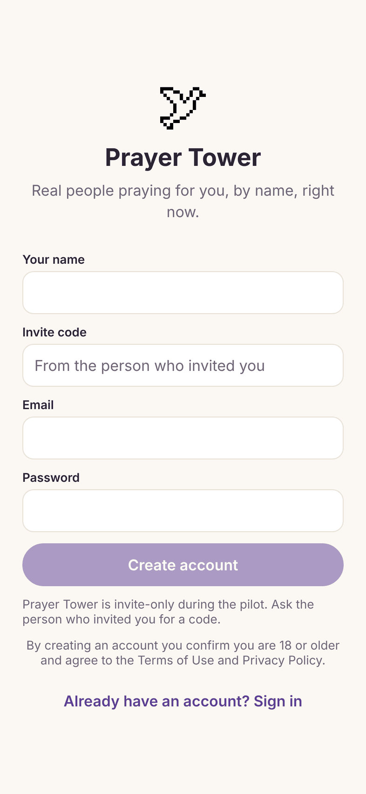
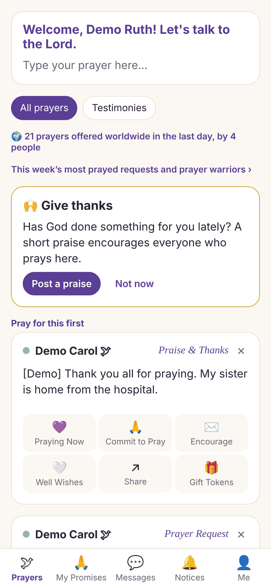
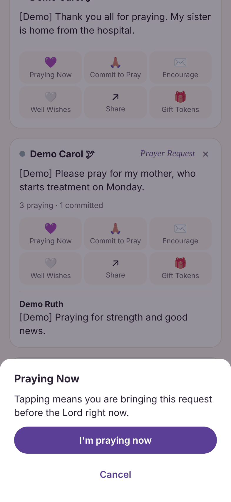
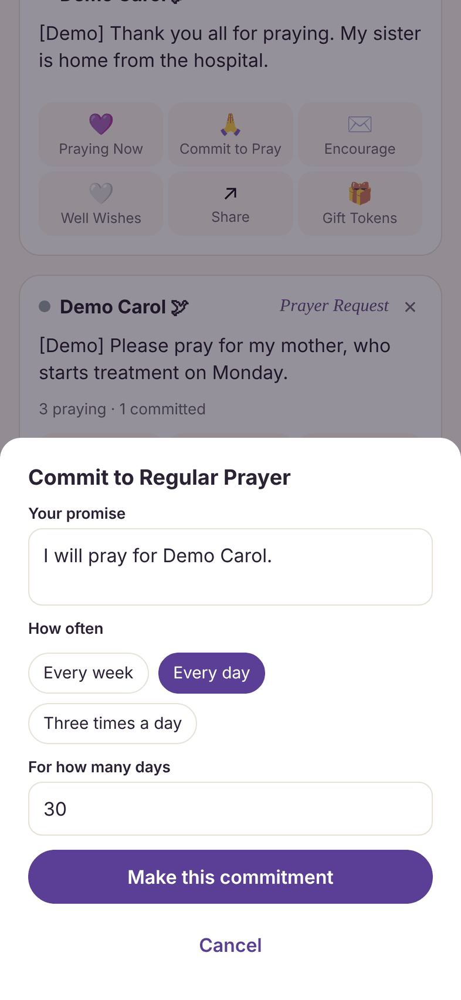
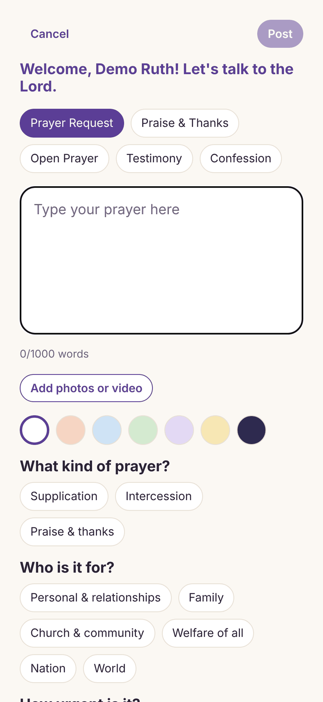
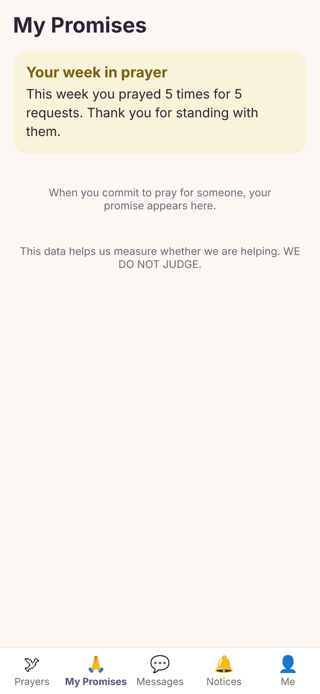
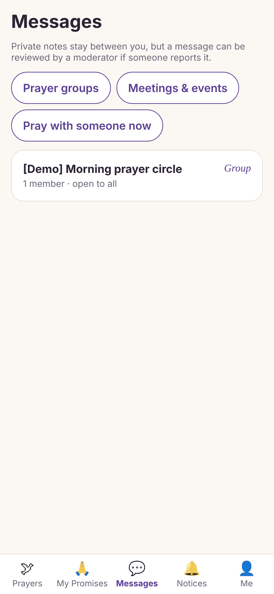

# Testing Prayer Tower

Thank you for helping. This page tells you how to install the test app, what to try, and how to tell us what you find.

## 1. Install the app

**iPhone**

1. Open the email from TestFlight on your iPhone and tap **View in TestFlight**. If you don't have the TestFlight app, the link takes you to the App Store to install it first.
2. In TestFlight, tap **Accept**, then **Install**.
3. Open **Prayer Tower** from your home screen.

Test builds expire after 90 days. TestFlight will offer updates; tap **Update** when it does.

Prayer Tower is in English and runs on iPhone (it also works on iPad). The pictures below show sample requests marked [Demo].

## 2. Create your account

1. Open Prayer Tower and tap **New here? Create an account**.
2. Fill in your name, the **invite code** from your invitation, the email address the invitation was sent to, and a password. Then tap **Create account**.
3. Open the email Prayer Tower sends you and confirm your address, then come back and sign in.
4. Answer the few welcome questions. A short tour shows how things work; you can see it again any time from **Me → How Prayer Tower works**.

If the app says your invite code isn't valid, check it for typos, or reply to your invitation for a new one.

## 3. What to try

Please do a little each day rather than everything at once.

**Week 1: the basics**
- Pray for three requests on the **Prayers** tab. Tap **Praying Now**, then **I'm praying now**, while you pray.
- Post one request of your own: tap **Type your prayer here…** at the top of Prayers, write it, and tap **Post**. Turn on **Post anonymously** if you'd rather not show your name.
- Tap **Commit to Pray** on one request, choose how often, and tap **Make this commitment**. Your promises are on the **My Promises** tab, and the app reminds you.

   

**Week 2: community**
- Tap **Encourage** on a request you prayed for and send a short note.
- On the **Messages** tab, open **Meetings & events** and tap **I'm going** on one, or join one under **Prayer groups**.
- Open one of your requests and tap **Mark this prayer answered**, or post a **Praise & Thanks**.

 

**Week 3: tokens and reach**
- Each prayer you offer for someone else earns a token. See yours under **Me**, and use **Gift Tokens** on a request to help it reach more people.
- Try **Messages → Pray with someone now** if you'd like a prayer partner to pray with you.

**Week 4: anything you like**
- Use the app the way you naturally would, and note what you'd change.

## 4. Report a problem or an idea

- In the app: **Me → Send feedback**. Pick **Something broke**, **An idea** or **Something else**, then say what you did, what you expected, and what happened. The app version is added for you.
- Something harmful or unsafe in a request: open the request and tap **Report this request**. A moderator reviews every report.
- No connection? The app says "You're offline" and shows a **Try again** button. Prayers and posts you make offline are sent when you're back online.

- Can't open the app at all: email **[SUPPORT EMAIL]**.

A screenshot helps a lot. On iPhone press the side button and volume-up together.

## 5. Your privacy

- Only the words of a request go out by radio, never your name.
- You can block anyone: tap their name, then **Block**.
- **Me → Download my data** gives you a copy of everything on your account.
- **Me → Delete my account** removes your account, posts and activity for good.

The full privacy policy is at [PRIVACY URL].

## 6. If you're in crisis

Prayer Tower is not an emergency service. If you or someone else is in danger, call **[911 / LOCAL EMERGENCY NUMBER]**, or call or text **[988 / LOCAL CRISIS LINE]**.
